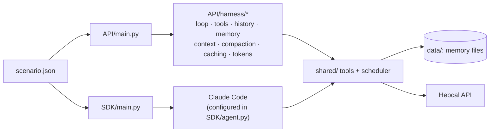

<div align="center">

# 🕯️ Erev Shabbat Countdown

**A personal agent that plans Friday backwards from candle lighting, so everything is done 10 minutes early.**

One agent, built twice: on the raw **Claude Messages API** and on the **Claude Agent SDK**, then measured side by side.


</div>

---

## ✨ What it does

- **Fetches candle lighting** for Jerusalem from the [Hebcal API](https://www.hebcal.com/home/developer-apis) and sets the ready time to candle lighting minus 10 minutes.
- **Builds a timeline backwards** with a deterministic Python scheduler, not the model:
  - Never two active tasks at once; passive ones (dough rising, oven, slow cooker) run alongside.
  - Respects dependencies, "must end by" times, and the shower as the last task before the checklist.
- **Ends with your last-minute checklist**: phone off, alarm, hot plate, light timers.
- **Suggests Thursday-night moves** when Friday is too short, and saves them only after you approve.
- **Learns real durations** from the weekly review and uses them in the following weeks.
- **Re-plans live** ("It's 13:00 and I'm 40 minutes behind"), dropping nice-to-have tasks first.
- **Keeps one-week changes separate** ("guests this Friday") from your permanent task templates.

> It plans logistics and timing only. Halachic questions are referred to a rav.

### Example: live re-plan

```
Fri 2026-11-06 candles 16:05 ready 15:55 | start 13:00 | slack 10
RE-PLAN from 13:00 (40 behind): dropped flowers (nice)
13:00-14:10 Challah (active)
14:10-14:25 Set table (active)
14:10-14:55 Challah rise (passive)
14:25-15:15 Shopping (active)
14:55-15:25 Challah bake (passive)
15:15-15:25 free
15:25-15:45 Shower (active, last)
15:45-15:55 Checklist: Turn off the phone, Set the alarm, Turn on the hot plate, Set the light timers
```

## ⚖️ API vs SDK at a glance

| | Messages API | Agent SDK |
|---|---|---|
| Harness code | 273 lines I wrote | 34 lines of configuration |
| Checks passed | 7/7 | 7/7 |
| Model calls | 21 | 19 |
| Cache read | 87.9% | 95.2% |
| Cost of the scenario | $0.199 | $0.195 (≈ $0.234 from a cold cache) |

Full analysis: **[REPORT.md](REPORT.md)**.

## 🏗️ How it fits together



Both versions call the same tools in `shared/`, so they differ only in the harness.

```
shared/        tools, scheduler, Hebcal client, memory files, checks, results
API/           main.py, agent.py, harness/ (8 files, one per responsibility)
SDK/           main.py, agent.py, tools.py (each harness replacement marked "# replaces:")
tests/         136 offline tests with fake Claude clients, no key needed
scenario.json  8 turns, 2 sessions, fixed dates
results/       api.json, sdk.json and run logs
```

## 🚀 Quick start

```powershell
python -m venv .venv
.venv\Scripts\python -m pip install -r requirements.txt
.venv\Scripts\python -m pytest -q
```

**API version.** Uses a Claude Console key, set in the terminal only:

```powershell
$env:ANTHROPIC_API_KEY = "sk-ant-..."
.venv\Scripts\python API\main.py --scenario scenario.json --out results\api.json --log results\api_run.log
```

**SDK version.** Uses your Claude Code login. Run it in a terminal *without* `ANTHROPIC_API_KEY`; the script refuses to run if the key is set:

```powershell
.venv\Scripts\python SDK\main.py --scenario scenario.json --out results\sdk.json --log results\sdk_run.log
```

Each run wipes its own `data/` folder, plays the 8 turns, runs the 7 checks on the saved state, and writes the results file.

## 🧪 The scenario

| Session | Turn | User says |
|---|---|---|
| 1 | 1–3 | Profile, 10 tasks, checklist |
| 1 | 4 | "Build my Friday plan." |
| 1 | 5 | "Challah took 90 minutes, cleaning only 40." |
| 2 | 6 | "Plan this Friday." The agent suggests moving cleaning to Thursday night |
| 2 | 7 | Approves the move; "we're guests Friday night" becomes a one-week override |
| 2 | 8 | "It's 13:00 and I'm 40 minutes behind." |

The checks verify the saved state, not the reply text:
- profile saved
- checklist saved and placed last in the timeline
- challah learned as 90 minutes, and used in session 2
- the week override limited to its own Friday
- a valid final timeline
- Hebcal called

## 📝 Notes

- **Secrets:** API keys are never written to files, and `.env` is git-ignored.
- **Filtered networks:** HTTPS goes through `truststore`, so it works on filtering networks such as NetFree that re-sign certificates. TLS checks stay on.
