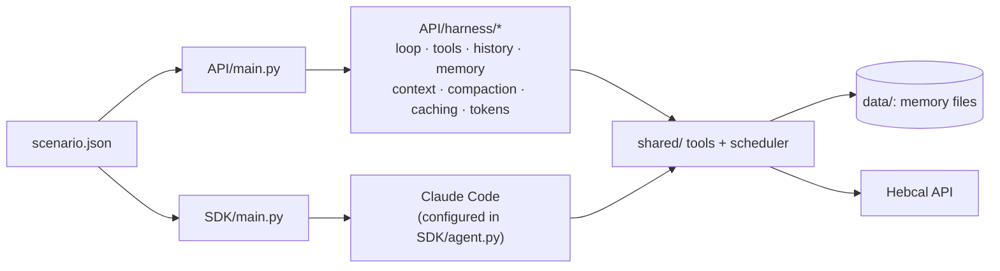
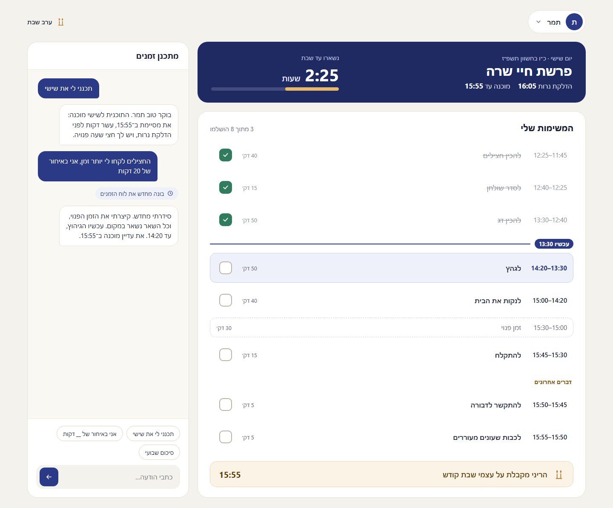
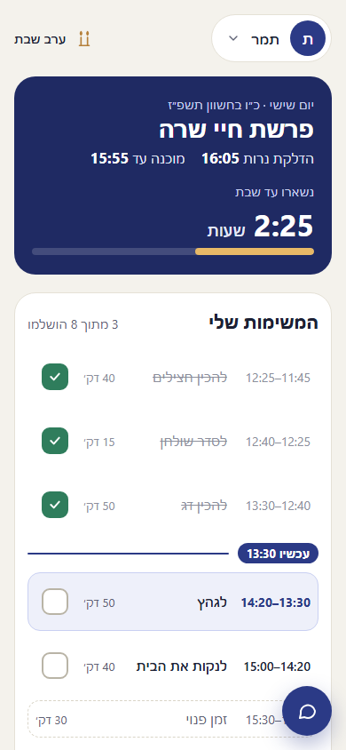
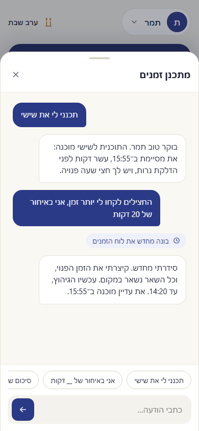

<div align="center">

# 🕯️ Erev Shabbat Countdown

**A personal agent that plans Friday backwards from candle lighting, so everything is done 10 minutes early.**

One agent, built twice: on the raw **Claude Messages API** and on the **Claude Agent SDK**, then measured side by side.


</div>

---

## ✨ What it does

- **Fetches candle lighting** for Jerusalem from the [Hebcal API](https://www.hebcal.com/home/developer-apis) and sets the ready time to candle lighting minus 10 minutes.
- **Builds a timeline backwards** with a deterministic Python scheduler, not the model:
  - Never two active tasks at once; passive ones (dough rising, oven, slow cooker) run alongside.
  - Respects dependencies, "must end by" times, and the shower as the last task before the checklist.
- **Ends with your last-minute checklist**: phone off, alarm, hot plate, light timers.
- **Suggests Thursday-night moves** when Friday is too short, and saves them only after you approve.
- **Learns real durations** from the weekly review and uses them in the following weeks.
- **Re-plans live** ("It's 13:00 and I'm 40 minutes behind"), dropping nice-to-have tasks first.
- **Keeps one-week changes separate** ("guests this Friday") from your permanent task templates.

> It plans logistics and timing only. Halachic questions are referred to a rav.

### Example: live re-plan

```
Fri 2026-11-06 candles 16:05 ready 15:55 | start 13:00 | slack 10
RE-PLAN from 13:00 (40 behind): dropped flowers (nice)
13:00-14:10 Challah (active)
14:10-14:25 Set table (active)
14:10-14:55 Challah rise (passive)
14:25-15:15 Shopping (active)
14:55-15:25 Challah bake (passive)
15:15-15:25 free
15:25-15:45 Shower (active, last)
15:45-15:55 Checklist: Turn off the phone, Set the alarm, Turn on the hot plate, Set the light timers
```

## ⚖️ API vs SDK at a glance

| | Messages API | Agent SDK |
|---|---|---|
| Harness code | 273 lines I wrote | 34 lines of configuration |
| Checks passed | 7/7 | 7/7 |
| Model calls | 21 | 19 |
| Cache read | 87.9% | 95.2% |
| Cost of the scenario | $0.199 | $0.195 (≈ $0.234 from a cold cache) |

Full analysis: **[REPORT.md](REPORT.md)**.

## 🏗️ How it fits together



Both versions call the same tools in `shared/`, so they differ only in the harness.

```
shared/        tools, scheduler, Hebcal client, memory files, checks, results
API/           main.py, agent.py, harness/ (8 files, one per responsibility)
SDK/           main.py, agent.py, tools.py (each harness replacement marked "# replaces:")
backend/       local FastAPI server for the web app, on top of the SDK agent
frontend/      the Hebrew web page (plain HTML, CSS and JS modules, no build step)
design/        the approved screen design the page is built from
tests/         offline tests with fake Claude clients, no key needed
scenario.json  8 turns, 2 sessions, fixed dates
results/       api.json, sdk.json and run logs
```

## 🚀 Quick start

```powershell
python -m venv .venv
.venv\Scripts\python -m pip install -r requirements.txt
.venv\Scripts\python -m pytest -q
```

**API version.** Uses a Claude Console key, set in the terminal only:

```powershell
$env:ANTHROPIC_API_KEY = "sk-ant-..."
.venv\Scripts\python API\main.py --scenario scenario.json --out results\api.json --log results\api_run.log
```

**SDK version.** Uses your Claude Code login. Run it in a terminal *without* `ANTHROPIC_API_KEY`; the script refuses to run if the key is set:

```powershell
.venv\Scripts\python SDK\main.py --scenario scenario.json --out results\sdk.json --log results\sdk_run.log
```

Each run wipes its own `data/` folder, plays the 8 turns, runs the 7 checks on the saved state, and writes the results file.

## 🖥️ Local web app

A one-screen Hebrew page for real Fridays, built on the SDK version: chat with the planner, and see this Friday's tasks in order with a live countdown to the ready time.



<p align="center">
  
  &nbsp;&nbsp;
  
</p>

<sub>Screenshots use sample data (the approved design's example day), not a real conversation.</sub>

**Start it** in a terminal without `ANTHROPIC_API_KEY` (like the SDK version, it runs on your Claude Code login and refuses to start if the key is set):

```powershell
.venv\Scripts\python -m backend
```

The browser opens at `http://127.0.0.1:8765`; Ctrl+C stops the server. Options: `--port 8765`, `--no-browser`, and `--name "תמר"` for the name shown on the page.

**What the screen shows**
- **Shabbat card:** the Hebrew date and parasha (from Hebcal), candle lighting, the ready time, a countdown to ready, and how much of the day has passed.
- **המשימות שלי:** this Friday's plan as one list, one task at a time, with a "now" marker, the next task highlighted, free time, and the last-minute checklist ("דברים אחרונים"). Tick a task when it's done; ticks are kept per Friday and start fresh each week.
- **מתכנן זמנים:** the chat. Replies stream in, a chip shows what the planner is doing, and quick prompts cover the common requests. On a phone the chat opens from a round button as a bottom sheet.

**How it behaves**
- **One conversation per week.** Messages resume the same Claude Code session, so the planner remembers the conversation across visits and restarts. A new Friday starts a fresh session; everything it learned stays in the saved files. "שיחה חדשה" in the profile menu starts over by hand.
- **App-only rules:** in the app every task is active (never two at once, enforced by a hook on the tools), the planner answers in Hebrew when you write Hebrew, and task names may be Hebrew. The scenario's system prompt is unchanged.
- **Reading is free.** The page reads the saved files directly; only chat messages call Claude. The page shows no cost; an estimate per message is in the server log and in `data/app/chat.jsonl`.
- **Local only.** The server binds to `127.0.0.1`, accepts only its own Host and Origin, and takes writes only as JSON from its own page, because it acts with your Claude Code account. The page loads nothing from the internet.
- **Its own data folder:** `data/app/` (git-ignored). The scenario runs never touch it. Delete it to start from scratch.

## 🧪 The scenario

| Session | Turn | User says |
|---|---|---|
| 1 | 1–3 | Profile, 10 tasks, checklist |
| 1 | 4 | "Build my Friday plan." |
| 1 | 5 | "Challah took 90 minutes, cleaning only 40." |
| 2 | 6 | "Plan this Friday." The agent suggests moving cleaning to Thursday night |
| 2 | 7 | Approves the move; "we're guests Friday night" becomes a one-week override |
| 2 | 8 | "It's 13:00 and I'm 40 minutes behind." |

The checks verify the saved state, not the reply text:
- profile saved
- checklist saved and placed last in the timeline
- challah learned as 90 minutes, and used in session 2
- the week override limited to its own Friday
- a valid final timeline
- Hebcal called

## 📝 Notes

- **Secrets:** API keys are never written to files, and `.env` is git-ignored.
- **Filtered networks:** HTTPS goes through `truststore`, so it works on filtering networks such as NetFree that re-sign certificates. TLS checks stay on.
